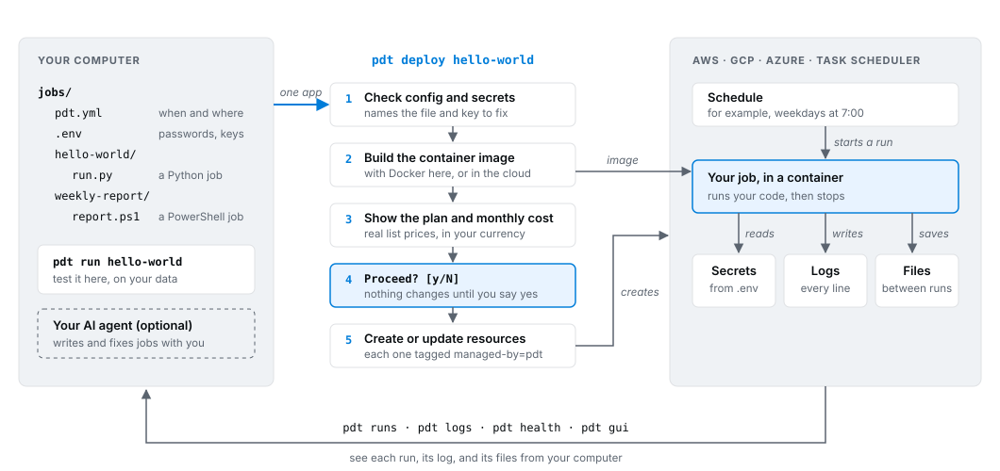
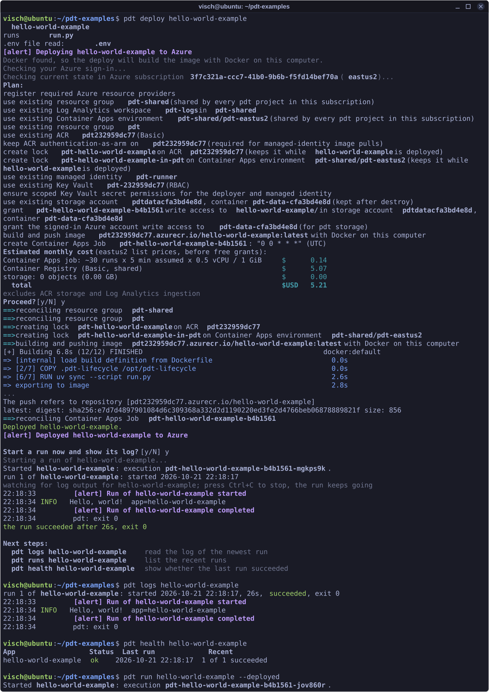

# pdt - process deploy tool

**Turn any script into a scheduled job in your cloud.**

pdt builds, runs, and deploys scheduled jobs to AWS, Azure, Google Cloud, or Windows Task Scheduler. It gives every job the same [primitives](docs/primitives.md#primitives), chosen from years of deploying scheduled jobs for businesses on each cloud. No servers to run and nothing extra to install, and everything it makes lives in your own account.



## Key Features

1. **Bring your scripts** - Drop in your PowerShell or Python files. pdt finds what they need and runs them.
2. **One command to deploy** - No cloud skills needed. `pdt deploy` installs the tools it needs and opens the sign-in page for you.
3. **Any cloud** - Move a job between AWS, Azure, Google Cloud, and Windows by changing one line.
4. **Know the cost first** - See the plan and a monthly cost estimate before anything changes.
5. **Know when it breaks** - Health checks, logs, a dashboard, and alerts to Slack, Teams, or email.

## Quick Start

### Windows

Download and run the [pdt installer](https://github.com/AutoIDM/pdt/releases/latest/download/pdt-windows-x64.msi).

### macOS / Linux - with uv

Install [uv](https://docs.astral.sh/uv/), then pdt:

On macOS or Linux, paste this line into a terminal. It installs `uv` if you do not have it, then installs pdt. Run it again to update pdt.

```
curl -LsSf https://github.com/AutoIDM/pdt/releases/latest/download/install.sh | sh
```

If you already have `uv`, you can run these lines instead:

```
curl -LsSf https://astral.sh/uv/install.sh | sh
source $HOME/.local/bin/env
uv tool install pdt-cli
uv tool update-shell
```

For other ways to install, and how to update or remove pdt, see [docs/install.md](docs/install.md).

### Deploy your first job

Then run:

```
pdt init jobs
cd jobs
pdt new hello-powershell --from powershell-hello-world
cd hello-powershell
pdt run
pdt deploy
pdt logs
```

### Deploy your own script

1. Create the job with `pdt new your-powershell-job --from powershell-hello-world`
2. Replace `hello.ps1` in the `your-powershell-job` folder with your own `.ps1` script
3. Test the job locally with `pdt run your-powershell-job`
4. Deploy it with `pdt deploy your-powershell-job`

See [every command](docs/commands.md).

### Example deployment

A first deploy of the `hello-world-example` app to Azure, then a look at its run:



See [the same output as text](docs/example-deploy.md).


## The bundled examples

Run `pdt examples` to list them, then `pdt new <name> --from <example>` to copy one.

### hello-world
Small job that logs "Hello world." `pdt init` puts a copy of this in every new empty project.

### azure-license-waste
PowerShell job. Finds the Microsoft 365 licenses a tenant pays for that nobody uses: paid licenses on disabled accounts, on accounts that have not signed in for 90 days (or never did), and seats bought but assigned to nobody. Each run keeps a `LicenseWaste-<date>.xlsx` workbook in the job's data store, with a Summary sheet of monthly and annual cost and one sheet per finding.

### impossible-travel-report
Looks at recent Entra ID sign-ins. Sends an email when one person signs in from two far-apart places too quickly: Dallas an hour ago, Paris now.

Settings for the lookback window, the minimum distance, and the email addresses live in the job's `config.yml`. The env vars it needs are listed there too, and in its `env.template`.

### intune-export

PowerShell job. Once a week it exports the Intune configuration of a tenant with the bulk export of [IntuneManagement](https://github.com/Micke-K/IntuneManagement) version 4, and keeps an `IntuneExport-<date>.zip` in the job's data store. To import, unzip it and point IntuneManagement's import at the company folder inside. 

### monday-orphaned-account-report
Reports active Monday users whose email address does not match the `userPrincipalName` of an active Entra ID user.

### powershell-hello-world
A PowerShell job whose one script, `hello.ps1`, writes "Hello, world!". It is the job the [Quick Start](#quick-start) deploys. Put your own `.ps1` files in its folder in place of `hello.ps1` to deploy your own PowerShell job.

### powershell-report
PowerShell job. small CSV report with `Export-Csv`, and pdt keeps the file in the app's data store.

## Support

[AutoIDM](https://autoidm.com/service) makes pdt. Any issues, questions, ideas, or concerns? Use any of these methods to get a hold of us:

1. [Discord](https://autoidm.com/discord)
2. Report a problem at https://github.com/AutoIDM/pdt/issues.

## Documentation

- [How pdt works](docs/primitives.md): the building blocks every job gets on each cloud, and the practices behind them
- [Projects and apps](docs/projects.md): set up a project, add an app, and where pdt keeps its files
- [Deploying](docs/deploy.md): deploy, run, pause, and destroy a job, and run pdt from CI
- [Commands](docs/commands.md): every `pdt` command and its options
- [Choosing where jobs run](docs/platforms.md): AWS, Azure, Google Cloud, Windows Task Scheduler, and your own Dockerfile
- [Keeping files between runs](docs/storage.md): the storage folder every app gets, and state that carries from one run to the next
- [The dashboard](docs/dashboard.md): `pdt gui`, the browser view of every app's runs, logs, and files
- [Writing your own app](docs/writing-apps.md): Python and PowerShell apps, and logging
- [Sending email](docs/email.md): send mail from an app over SMTP, Microsoft Graph, SES, or Resend
- [More ways to install](docs/install.md): other installs, and how to update or remove pdt